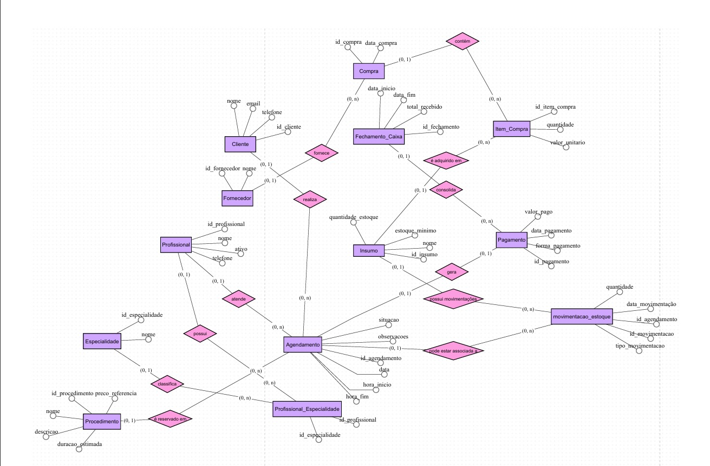
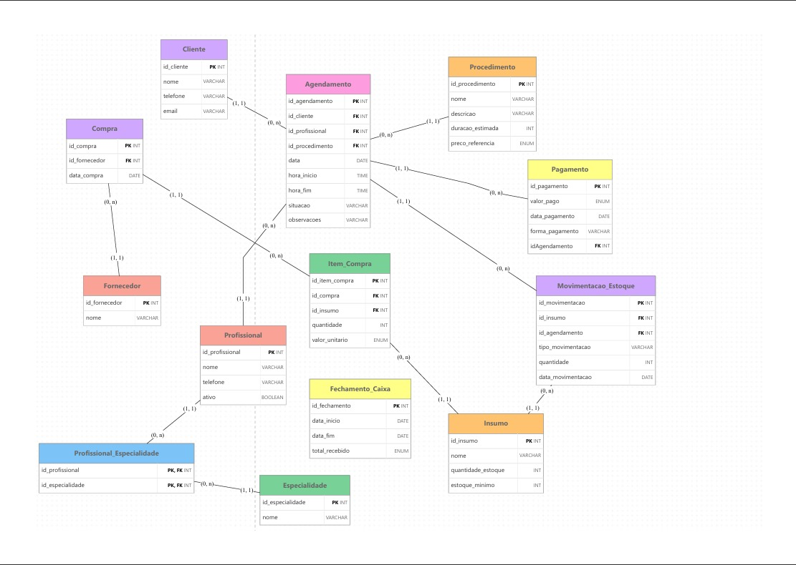

# 💇‍♀️ Salão dos Primos — Sistema de Gestão

> Projeto acadêmico de modelagem, implementação e documentação de banco de dados para o gerenciamento das informações do Salão dos Primos.

## 📌 Sobre o projeto

O projeto desenvolve um banco de dados relacional (MySQL) para organizar e centralizar as informações do Salão dos Primos: clientes, profissionais e suas especialidades, procedimentos, agendamentos, pagamentos, compras de insumos, estoque e fechamento de caixa.

Hoje o salão trabalha com caderno e WhatsApp. O banco substitui esse controle manual por um registro único, que permite consultar o histórico de atendimentos, evitar conflitos de horário, acompanhar recebimentos e saber quando um insumo precisa ser reposto.

* * *

# 👥 Integrantes

| Nome completo                  | RGM      | GitHub                                                                             |
|--------------------------------|----------|------------------------------------------------------------------------------------|
| Franciele Souza de Jesus       | 47643323 | [https://github.com/FrancieleSZ](https://github.com/FrancieleSZ)                   |
| Julia Parra                    | 47566604 | [https://github.com/juliaatriz](https://github.com/juliaatriz)                     |
| Emilly Rodrigues de Souza      | 47508248 | [https://github.com/emillyrodrigues-tech](https://github.com/emillyrodrigues-tech) |
| Kamilly Vitória Alves da Silva | 46919431 | [https://github.com/KamillyVicks](https://github.com/KamillyVicks)                 |

* * *

# 1. Relatório Técnico Final

## 1.1 Revisão do Modelo Conceitual

### Caracterização da organização

**Nome:** Salão dos Primos
**Natureza:** Organização real do ramo de prestação de serviços de beleza (continuidade da organização da Entrega 1).
**Responsável:** Alaide Souza Lacerda — cabeleireira — 11 94400-0738.
**Vínculo do grupo com a organização:**  Tia de uma das alunas do grupo, a Franciele Souza.

**Porte:**

- 4 profissionais.
- 30 a 50 clientes atendidos, segundo estimativa da responsável. Cerca de 30 atendimentos por semana.
- 1 unidade, com agendamento feito em caderno e WhatsApp e sem sistema informatizado.

### Problemas e necessidades identificados

Todos os problemas abaixo são resolvidos pelo modelo; a ligação com as tabelas e consultas está na seção 1.6.

- **P1 — Agenda sem verificação de conflitos:** os horários ficam no caderno e no WhatsApp; nada impede dois atendimentos do mesmo profissional no mesmo horário.
- **P2 — Sem histórico organizado:** não há registro por cliente, profissional ou procedimento; os contatos ficam espalhados entre caderno e WhatsApp.
- **P3 — Cancelamentos e remarcações sem registro:** são combinados pelo WhatsApp, então não dá para medir a taxa de cancelamento.
- **P4 — Valores e recebimentos sem controle:** o preço é definido depois da avaliação e o valor realmente cobrado não fica registrado; não há total recebido por período.
- **P5 — Insumos e compras sem controle:** não há registro de compras por fornecedor, estoque de insumos nem alerta de reposição.

### Escopo do sistema

O modelo cobre todos os dados da organização, não apenas a agenda: atendimento, financeiro e estoque. São 13 entidades:

01. Cliente;
02. Profissional;
03. Especialidade;
04. Profissional_Especialidade;
05. Procedimento;
06. Agendamento;
07. Pagamento;
08. Fornecedor;
09. Compra;
10. Item_Compra;
11. Insumo;
12. Movimentacao_Estoque;
13. Fechamento_Caixa.

### Justificativa da escolha

O Salão dos Primos é uma organização real, com atendimento diário, equipe de 4 profissionais e todos os processos feitos à mão. Isso permite aplicar a modelagem a um caso concreto, com problemas verificáveis na visita, e a solução proposta tem uso prático para a responsável.

### Evidências da organização

- Endereço: R. Bernardino Vergueiro, 276 - Jardim Jaú (Zona Leste), São Paulo - SP, 03710-060.
- Google Meu Negócio / Google Maps: https://share.google/cTK1avqQON6QACScm
- Contato: 11 94696-7621.
- Fotografias da visita e da entrevista: 


**Responsável pela organização:** Alaide Souza Lacerda — 11 94400-0738.

### Relato da entrevista

- **Entrevistada:** Alaide Souza Lacerda, responsável pelo salão.
- **Integrante participante:** Franciele Souza de Jesus.
- **Data:** 20/09/2026.
- **Local:** Salão dos Primos, no ambiente da organização.

**Informações obtidas na entrevista:**
O salão faz seus agendamentos de forma manual, principalmente em um caderno e pelo WhatsApp. O controle é feito pela própria responsável, que registra os compromissos, consulta a disponibilidade dos profissionais e combina os procedimentos com os clientes. Os valores dos serviços variam conforme a necessidade de cada cliente e são definidos depois de uma avaliação prévia. O salão não usa nenhum sistema informatizado.

**Observações presenciais:**
Durante a visita, o grupo viu uma organização simples, com processos administrativos feitos à mão: agendamentos anotados em caderno e complementados por conversas no WhatsApp. Não havia computadores nem sistemas de gestão em uso. A responsável concentra a organização de horários, o contato com clientes e a definição dos serviços.

**Comprovação:** fotografia da entrevista no repositório, em `evidencias/`.

O levantamento completo, com o que foi dito, o que foi observado e os pontos a confirmar, está em .

### Processos de negócio

Os processos e as tabelas que os registram:

- **Cadastro de cliente** — nome completo, telefone, e-mail, data de cadastro e observações → `Cliente`.
- **Cadastro de profissional e especialidades** — nome completo, telefone, data de admissão, situação ativo/inativo e as especialidades que exerce → `Profissional`, `Especialidade`, `Profissional_Especialidade`.
- **Cadastro de procedimento** — nome, descrição, duração estimada e preço de referência → `Procedimento`.
- **Agendamento** — a cliente pede o horário (WhatsApp ou no salão); a responsável confere a disponibilidade do profissional e anota cliente, profissional, procedimento, data, hora de início, hora de fim, situação e observações → `Agendamento`.
- **Cancelamento, remarcação e conclusão** — alteram a situação (AGENDADO, CANCELADO, CONCLUIDO) ou a data e o horário do agendamento, sem apagar o registro → `Agendamento`.
- **Pagamento** — feito no salão depois do atendimento, com o valor definido na avaliação, a data e a forma de pagamento → `Pagamento`.
- **Compra de insumos** — fornecedor, data e, por item, insumo, quantidade e valor unitário → `Fornecedor`, `Compra`, `Item_Compra`.
- **Controle de estoque** — insumos com quantidade em estoque e estoque mínimo; entradas pelas compras e saídas pelo consumo nos atendimentos → `Insumo`, `Movimentacao_Estoque`.
- **Fechamento de caixa** — total recebido entre uma data de início e uma data de fim → `Fechamento_Caixa`.

### Requisitos funcionais

| Código | Descrição                                                                                                                                                              |
|--------|------------------------------------------------------------------------------------------------------------------------------------------------------------------------|
| RF01   | Cadastrar cliente com nome completo, telefone com DDD, e-mail (opcional), data de cadastro e observações.                                                              |
| RF02   | Cadastrar procedimento com nome, descrição, duração estimada (em minutos) e preço de referência.                                                                       |
| RF03   | Cadastrar profissional com nome completo, telefone, data de admissão e situação (ativo/inativo), e vincular suas especialidades (nome e descrição).                     |
| RF04   | Registrar agendamento com cliente, profissional, procedimento, data, hora de início, hora de fim, situação e observações.                                              |
| RF05   | Impedir conflito de horário: o mesmo profissional não pode ter dois agendamentos AGENDADO no mesmo dia com horários sobrepostos.                                       |
| RF06   | Cancelar agendamento, alterando a situação para CANCELADO e mantendo o registro.                                                                                       |
| RF07   | Remarcar agendamento, alterando data, hora de início e hora de fim.                                                                                                    |
| RF08   | Consultar a agenda dos profissionais por dia, com cliente, procedimento e horário.                                                                                     |
| RF09   | Registrar a conclusão do atendimento, alterando a situação para CONCLUIDO.                                                                                             |
| RF10   | Consultar o histórico de agendamentos por cliente, profissional, procedimento e período.                                                                               |
| RF11   | Registrar pagamento com agendamento, valor pago, data e forma de pagamento (DINHEIRO, PIX, CARTAO_DEBITO ou CARTAO_CREDITO).                                           |
| RF12   | Cadastrar fornecedor (nome e telefone) e registrar compra (fornecedor e data).                                                                                         |
| RF13   | Registrar os itens de cada compra com insumo, quantidade e valor unitário.                                                                                             |
| RF14   | Cadastrar insumo com nome, unidade de medida, quantidade em estoque e estoque mínimo, e listar os que estão abaixo do mínimo.                                          |
| RF15   | Registrar movimentação de estoque com insumo, tipo (ENTRADA ou SAIDA), quantidade, data e, quando houver, o agendamento que consumiu o insumo.                         |
| RF16   | Consultar as movimentações de estoque por insumo e por período.                                                                                                        |
| RF17   | Fechar o caixa por período, com data de início, data de fim e total recebido calculado pela soma dos pagamentos do período.                                            |

### Requisitos não funcionais

| Código | Descrição                                                                                                  |
|--------|------------------------------------------------------------------------------------------------------------|
| RNF01  | O banco de dados deverá ser implementado utilizando MySQL 8.0.16 ou superior.                              |
| RNF02  | O sistema deverá manter a integridade dos relacionamentos por meio de chaves primárias e estrangeiras.     |
| RNF03  | Os dados deverão ser armazenados de maneira organizada e estruturada.                                      |
| RNF04  | O acesso às informações deverá respeitar as permissões definidas para cada usuário.                        |
| RNF05  | O projeto deverá considerar a proteção dos dados pessoais dos clientes, respeitando os princípios da LGPD. |

### Regras de negócio

| Código | Regra                                                                                                                                                       |
|--------|-------------------------------------------------------------------------------------------------------------------------------------------------------------|
| RN01   | Todo agendamento deve estar associado a um cliente cadastrado.                                                                                              |
| RN02   | Todo agendamento deve estar associado a um profissional.                                                                                                    |
| RN03   | Todo agendamento deve estar associado a um procedimento.                                                                                                    |
| RN04   | Um profissional não pode ter agendamentos AGENDADO no mesmo dia com horários sobrepostos (início anterior ao fim do outro e fim posterior ao início do outro). |
| RN05   | Profissionais inativos não podem receber novos agendamentos.                                                                                                |
| RN06   | Um agendamento pode possuir, no máximo, um pagamento registrado.                                                                                            |
| RN07   | Cada compra deve estar associada a um fornecedor.                                                                                                           |
| RN08   | Cada item de compra deve estar associado a uma compra e a um insumo, com quantidade maior que zero; o mesmo insumo não se repete na mesma compra.           |
| RN09   | Toda movimentação de estoque deve estar associada a um insumo, ter tipo ENTRADA ou SAIDA e quantidade maior que zero.                                       |
| RN10   | O fechamento de caixa deve considerar os pagamentos registrados dentro do período informado (a data final não pode ser anterior à inicial).                 |
| RN11   | Todo atendimento com situação CONCLUIDO deve ter pagamento registrado; os que ainda não têm ficam como pendência para a auditoria.                          |
| RN12   | O telefone do cliente é obrigatório, tem 10 ou 11 dígitos (com DDD) e é único; o e-mail, quando informado, é único e tem formato válido.                    |
| RN13   | A quantidade em estoque de um insumo nunca pode ser negativa.                                                                                               |

As regras RN01 a RN10 mantêm os códigos da Entrega 1. RN11, RN12 e RN13 são novas.

### O que ficou fora do modelo

| Item não incluído                | Por quê                                                                                       |
|----------------------------------|-----------------------------------------------------------------------------------------------|
| Comissão dos profissionais       | Não apareceu na entrevista; o grupo não sabe como o salão remunera cada profissional.        |
| Venda de produtos ao cliente     | Não foi mencionada; o foco do salão é a prestação de serviços.                                |
| Pacotes e programa de fidelidade | Não foram mencionados na entrevista.                                                          |
| Lembretes automáticos            | A comunicação com a cliente é feita pelo WhatsApp, fora do banco de dados.                    |
| CPF do cliente                   | Decisão do grupo de coletar o mínimo de dados pessoais (RNF05); o telefone identifica a cliente. |
| Nota fiscal                      | Fora do escopo do banco de dados da disciplina.                                               |

### DER conceitual revisado

O DER conceitual representa as entidades, seus atributos e os relacionamentos, na notação do brModelo. Os atributos ficam só no DER; as chaves estrangeiras aparecem apenas no modelo lógico.

**Ferramenta utilizada:** brModelo.

[](docs/DER_conceitual.png)

**Atributos por entidade** (identificador em **negrito**):

| Entidade                   | Atributos                                                                       |
|----------------------------|---------------------------------------------------------------------------------|
| Cliente                    | **id_cliente**, nome_completo, telefone, email, data_cadastro, observacoes      |
| Profissional               | **id_profissional**, nome_completo, telefone, data_admissao, ativo              |
| Especialidade              | **id_especialidade**, nome, descricao                                           |
| Procedimento               | **id_procedimento**, nome, descricao, duracao_estimada, preco_referencia        |
| Agendamento                | **id_agendamento**, data_agendamento, hora_inicio, hora_fim, situacao, observacoes |
| Pagamento                  | **id_pagamento**, valor_pago, data_pagamento, forma_pagamento                   |
| Fornecedor                 | **id_fornecedor**, nome, telefone                                               |
| Compra                     | **id_compra**, data_compra                                                      |
| Insumo                     | **id_insumo**, nome, unidade_medida, quantidade_estoque, estoque_minimo         |
| Movimentacao_Estoque       | **id_movimentacao**, tipo_movimentacao, quantidade, data_movimentacao           |
| Fechamento_Caixa           | **id_fechamento**, data_inicio, data_fim, total_recebido                        |
| Item_Compra (associativa)  | **id_item_compra**, quantidade, valor_unitario                                  |

**Relacionamentos e cardinalidades (mín, máx):**

| Relacionamento              | Entidade A                  | Entidade B                   |
|-----------------------------|-----------------------------|------------------------------|
| Cliente realiza Agendamento | Cliente (0, n)              | Agendamento (1, 1)           |
| Profissional atende         | Profissional (0, n)         | Agendamento (1, 1)           |
| Procedimento é executado em | Procedimento (0, n)         | Agendamento (1, 1)           |
| Profissional possui         | Profissional (1, n)         | Especialidade (0, n)         |
| Agendamento gera Pagamento  | Agendamento (0, 1)          | Pagamento (1, 1)             |
| Fornecedor fornece Compra   | Fornecedor (0, n)           | Compra (1, 1)                |
| Compra contém Insumo (associativa Item_Compra) | Compra (1, n) | Insumo (0, n)         |
| Insumo é movimentado        | Insumo (0, n)               | Movimentacao_Estoque (1, 1)  |
| Agendamento consome         | Agendamento (0, n)          | Movimentacao_Estoque (0, 1)  |

`Fechamento_Caixa` não tem relacionamento direto: o total é calculado pelas datas dos pagamentos (RN10).

### Revisões realizadas em relação à Entrega 1

| Apontamento da correção ou ponto revisado | Alteração realizada                                                                                   | Por quê                                                                                         |
|-------------------------------------------|-------------------------------------------------------------------------------------------------------|-------------------------------------------------------------------------------------------------|
| DER conceitual e lógico incompatíveis com o relatório | DER conceitual, DER lógico, README e script passaram a ter as mesmas 13 entidades e os mesmos atributos | O modelo precisa ser o mesmo em todos os artefatos, senão o erro passa para o SQL.            |
| Chaves estrangeiras no DER conceitual     | Removidas do conceitual; ficam no modelo lógico                                                       | A FK é decisão do modelo lógico, não do conceitual.                                            |
| Pagamento ausente                         | Criada a entidade `Pagamento` (0,1 por agendamento) com valor pago, data e forma                      | O preço é definido após avaliação; sem o pagamento não se sabe o que foi cobrado nem o total recebido. |
| Fornecedor ausente ou sem explicação      | Incluídos `Fornecedor`, `Compra` e `Item_Compra`, com explicação do papel de cada um                  | Sem eles não há como saber de quem e quanto se comprou.                                        |
| Estoque ausente                           | Incluídos `Insumo` e `Movimentacao_Estoque`                                                           | Permite listar insumos abaixo do mínimo (P5).                                                  |
| Escopo, processos, requisitos e regras superficiais | Todos detalhados com os campos de cada tabela; criadas RN11 a RN13                          | O nível de detalhe precisa citar todos os campos do trabalho.                                  |

* * *

## 1.2 Conversão do Modelo Conceitual para o Modelo Lógico

Cada entidade virou uma tabela e cada atributo virou uma coluna, com tipo definido (ver [dicionário de dados](docs/dicionario_dados.html)). Os relacionamentos foram convertidos conforme a cardinalidade:

| Relacionamento                          | Cardinalidade | Como foi convertido                                                              |
|-----------------------------------------|---------------|----------------------------------------------------------------------------------|
| Cliente — Agendamento                   | 1:N           | FK `id_cliente` em `Agendamento` (NOT NULL, pois a cardinalidade é (1,1))        |
| Profissional — Agendamento              | 1:N           | FK `id_profissional` em `Agendamento`                                            |
| Procedimento — Agendamento              | 1:N           | FK `id_procedimento` em `Agendamento`                                            |
| Profissional — Especialidade            | N:N           | Tabela associativa `Profissional_Especialidade`, com PK composta                 |
| Agendamento — Pagamento                 | 1:0..1        | FK `id_agendamento` em `Pagamento`, com UNIQUE (RN06)                            |
| Fornecedor — Compra                     | 1:N           | FK `id_fornecedor` em `Compra`                                                   |
| Compra — Insumo                         | N:N           | Entidade associativa `Item_Compra` (FKs `id_compra` e `id_insumo`, mais quantidade e valor unitário) |
| Insumo — Movimentacao_Estoque           | 1:N           | FK `id_insumo` em `Movimentacao_Estoque`                                         |
| Agendamento — Movimentacao_Estoque      | 1:N opcional  | FK `id_agendamento` em `Movimentacao_Estoque`, aceitando NULL                    |

Não há atributos multivalorados nem compostos e não há especialização no modelo. `Fechamento_Caixa` não tem FK: o total é calculado pelo período (RN10), e a consulta de auditoria A05 confere esse total.

* * *

## 1.3 Definição de Chaves Primárias e Estrangeiras

| Tabela                     | Chave primária                     | Chaves estrangeiras                          |
|----------------------------|------------------------------------|----------------------------------------------|
| Cliente                    | id_cliente                         | —                                            |
| Profissional               | id_profissional                    | —                                            |
| Especialidade              | id_especialidade                   | —                                            |
| Profissional_Especialidade | id_profissional + id_especialidade | id_profissional, id_especialidade            |
| Procedimento               | id_procedimento                    | —                                            |
| Agendamento                | id_agendamento                     | id_cliente, id_profissional, id_procedimento |
| Pagamento                  | id_pagamento                       | id_agendamento                               |
| Fornecedor                 | id_fornecedor                      | —                                            |
| Compra                     | id_compra                          | id_fornecedor                                |
| Insumo                     | id_insumo                          | —                                            |
| Item_Compra                | id_item_compra                     | id_compra, id_insumo                         |
| Movimentacao_Estoque       | id_movimentacao                    | id_insumo, id_agendamento                    |
| Fechamento_Caixa           | id_fechamento                      | —                                            |

* * *

## 1.4 Processo de Normalização (1FN, 2FN e 3FN)

Para cada forma normal, o problema que existiria no modelo sem ela e a correção aplicada:

### Primeira Forma Normal (1FN)

- **Problema:** guardar as especialidades do profissional numa só coluna ("Corte, Coloração, Escova") quebraria a atomicidade e impediria consultar "quem faz coloração?".
  **Correção:** `Especialidade` virou tabela própria, ligada por `Profissional_Especialidade`.
- **Problema:** registrar uma compra com vários produtos na mesma linha repetiria colunas (insumo1, insumo2...).
  **Correção:** cada produto comprado é uma linha em `Item_Compra`.

### Segunda Forma Normal (2FN)

- **Problema:** se `Item_Compra` usasse a chave composta (compra, insumo) e guardasse o nome do insumo, esse nome dependeria só do insumo, não da chave inteira (dependência parcial).
  **Correção:** o nome e os dados do insumo ficam em `Insumo`; `Item_Compra` guarda só quantidade e valor unitário, que dependem da compra e do insumo juntos.
- `Profissional_Especialidade` tem chave composta e nenhum atributo extra, então não há dependência parcial.

### Terceira Forma Normal (3FN)

- **Problema:** gravar em `Agendamento` o nome do cliente, o nome do profissional e o nome do procedimento criaria dependências transitivas (`id_profissional → nome`) e repetiria o mesmo texto em cada agendamento.
  **Correção:** esses dados ficam em `Cliente`, `Profissional` e `Procedimento`; `Agendamento` guarda só as FKs.
- **Problema:** o telefone do fornecedor em `Compra` se repetiria a cada compra e dependeria de `id_fornecedor`, não de `id_compra`.
  **Correção:** o telefone fica em `Fornecedor`.

### Redundâncias mantidas de propósito

- `Insumo.quantidade_estoque` pode ser calculada pelas movimentações. Fica gravada para consultar o estoque rapidamente e é conferida pela auditoria A06.
- `Fechamento_Caixa.total_recebido` pode ser calculado pelos pagamentos. Fica gravado porque um caixa já fechado não deve mudar se um pagamento for corrigido depois; a auditoria A05 compara os dois valores.

* * *

## 1.5 Justificativas Técnicas das Decisões

### Chaves primárias

Todas as tabelas principais usam um identificador próprio (`id_cliente`, `id_agendamento`...) em `INT AUTO_INCREMENT`. Nome, telefone e e-mail podem mudar ou se repetir, e um identificador estável é mais seguro para ligar as tabelas. Só `Profissional_Especialidade` usa chave composta, pois o par profissional + especialidade já identifica o registro.

### Chaves estrangeiras

As FKs impedem referências a registros que não existem (RN01 a RN03, RN07 a RN09). Nenhuma FK usa exclusão em cascata: o histórico de atendimentos, pagamentos e compras não deve sumir quando alguém é removido. Por isso o cliente 17 só pode ser excluído (DELETE D01 do script) por não ter agendamento.

### Restrições de integridade

| Restrição | Onde | Regra |
|-----------|------|-------|
| `UNIQUE` em `Cliente.telefone` e `Cliente.email` | Cliente | RN12 |
| `CHECK` telefone com 10 ou 11 dígitos | Cliente, Profissional, Fornecedor | RN12 |
| `UNIQUE` em `Pagamento.id_agendamento` | Pagamento | RN06 |
| `CHECK` situação em (AGENDADO, CONCLUIDO, CANCELADO) | Agendamento | RF06, RF09 |
| `CHECK` `hora_fim > hora_inicio` | Agendamento | RN04 (base do cálculo de conflito) |
| `CHECK` forma de pagamento em (DINHEIRO, PIX, CARTAO_DEBITO, CARTAO_CREDITO) | Pagamento | RF11 |
| `CHECK` `valor_pago > 0` | Pagamento | RF11 |
| `UNIQUE (id_compra, id_insumo)` e `CHECK` quantidade > 0 | Item_Compra | RN08 |
| `CHECK` tipo em (ENTRADA, SAIDA) e quantidade > 0 | Movimentacao_Estoque | RN09 |
| `CHECK` `quantidade_estoque >= 0` | Insumo | RN13 |
| `CHECK` `data_fim >= data_inicio` e `UNIQUE (data_inicio, data_fim)` | Fechamento_Caixa | RN10 |
| `NOT NULL` nas colunas obrigatórias; `DEFAULT` em `situacao` ('AGENDADO'), `ativo` (TRUE), `data_cadastro` (data de hoje) e estoques (0) | Várias | RF04, RN05 |

### Decisões gerais

- **Triggers para RN04 e RN05:** o `CHECK` só enxerga a própria linha e não consegue comparar horários entre agendamentos. Por isso duas triggers em `Agendamento` (antes de inserir e antes de atualizar) bloqueiam conflito de horário e profissional inativo.
- **Preço de referência × valor pago:** o preço é definido após avaliação (entrevista). Por isso `Procedimento.preco_referencia` é só uma base e o valor real fica em `Pagamento.valor_pago`.
- **Cancelar sem apagar:** o cancelamento muda a situação do agendamento (RF06), o que mantém o histórico e permite calcular a taxa de cancelamento (P3).
- **Estoque pelas movimentações:** toda entrada e saída é uma linha em `Movimentacao_Estoque`, o que dá histórico e permite a auditoria A06.
- **Sem CPF:** o telefone já identifica a cliente e o grupo preferiu guardar o mínimo de dados pessoais (RNF05).

* * *

## 1.6 Proposta de Arquitetura Analítica para BI e IA

### Indicadores gerenciais (KPIs) propostos

Cada KPI tem fórmula, período e meta proposta (a validar com a responsável).

| Cód. | Indicador                              | Fórmula                                                       | Período | Meta proposta               | Consulta |
|------|----------------------------------------|---------------------------------------------------------------|---------|-----------------------------|----------|
| K1   | Agendamentos por semana                | contagem de agendamentos                                      | semanal | acompanhar a tendência      | G01      |
| K2   | Taxa de cancelamento                   | cancelados ÷ total de agendamentos × 100                      | mensal  | até 10%                     | G03      |
| K3   | Atendimentos concluídos por profissional | contagem de agendamentos CONCLUIDO por profissional         | mensal  | distribuição equilibrada    | G02      |
| K4   | Procedimentos mais realizados          | contagem de CONCLUIDO por procedimento                        | mensal  | acompanhar o ranking        | G04      |
| K5   | Faturamento e ticket médio             | soma de `valor_pago`; ticket médio = soma ÷ nº de pagamentos  | semanal | acompanhar a tendência      | G05, G06 |
| K6   | Insumos abaixo do estoque mínimo       | contagem de insumos com estoque < mínimo                      | semanal | 0                           | G07      |
| K7   | Gasto com compras por fornecedor       | soma de quantidade × valor unitário por fornecedor            | mensal  | acompanhar a tendência      | G08      |
| K8   | Atendimentos concluídos sem pagamento  | contagem de CONCLUIDO sem registro em `Pagamento`             | semanal | 0                           | A03      |

### Potencial para BI

Os dados podem alimentar um painel (por exemplo Power BI ou Metabase, ligado ao MySQL) com:

- agendamentos por semana e taxa de cancelamento;
- ranking de procedimentos e atendimentos por profissional;
- faturamento semanal, ticket médio e forma de pagamento;
- insumos abaixo do mínimo e gasto por fornecedor.

As consultas G01 a G08 já entregam esses números e podem virar visões (views) para o painel.

### Aplicações analíticas e de IA

Com meses de histórico, é possível explorar:

- **Previsão de demanda** por dia da semana e por procedimento, para organizar a escala dos profissionais.
- **Previsão de falta de insumos**, usando o consumo registrado em `Movimentacao_Estoque`, para sugerir quando comprar.
- **Risco de cancelamento ou falta**, usando o histórico de cada cliente, para decidir quem receber um lembrete.

São propostas futuras: dependem de volume e qualidade de dados que o salão ainda vai acumular.

### Rastreabilidade

| Problema ou KPI                          | Tabelas envolvidas                                                         | Consulta no script       |
|------------------------------------------|----------------------------------------------------------------------------|--------------------------|
| P1 — Agenda sem verificação de conflitos | Agendamento, Profissional, Cliente, Procedimento                           | G09, A01, A02            |
| P2 — Sem histórico organizado            | Cliente, Agendamento, Profissional, Procedimento, Especialidade            | G01, G02, G04, G10, S01, S02 |
| P3 — Cancelamentos sem registro          | Agendamento                                                                | G03                      |
| P4 — Valores e recebimentos sem controle | Pagamento, Agendamento, Fechamento_Caixa                                   | G05, G06, A03, A05       |
| P5 — Insumos e compras sem controle      | Insumo, Compra, Item_Compra, Fornecedor, Movimentacao_Estoque              | G07, G08, S03, A06       |
| K1 — Agendamentos por semana             | Agendamento                                                                | G01                      |
| K2 — Taxa de cancelamento                | Agendamento                                                                | G03                      |
| K3 — Atendimentos por profissional       | Agendamento, Profissional                                                  | G02                      |
| K4 — Procedimentos mais realizados       | Agendamento, Procedimento                                                  | G04                      |
| K5 — Faturamento e ticket médio          | Pagamento                                                                  | G05, G06                 |
| K6 — Insumos abaixo do mínimo            | Insumo                                                                     | G07                      |
| K7 — Gasto por fornecedor                | Fornecedor, Compra, Item_Compra                                            | G08                      |
| K8 — Concluídos sem pagamento            | Agendamento, Pagamento                                                     | A03                      |

* * *

# 2. Modelo Lógico Relacional

O modelo lógico apresenta as 13 tabelas com colunas, tipos, chaves primárias, chaves estrangeiras e cardinalidades. NOT NULL, UNIQUE, CHECK e DEFAULT não aparecem no brModelo; estão no [dicionário de dados](docs/dicionario_dados.html) e no script SQL.

**Ferramenta utilizada:** brModelo.

[](docs/DER_logico.png)

* * *

# 3. Script SQL Completo

O banco foi implementado para **MySQL 8.0.16 ou superior**. O arquivo [`docs/script.sql`](docs/script.sql) segue esta ordem:

01. Criação do banco de dados (`salao_dos_primos`);
02. Criação das tabelas, com tipos adequados;
03. Constraints (PK, FK, NOT NULL, UNIQUE, CHECK, DEFAULT) e triggers das regras RN04 e RN05;
04. Inserção da massa de dados;
05. Consultas com `SELECT` e `JOIN` (S01 a S04);
06. `UPDATE` e `DELETE` (U01 a U03, D01);
07. Consultas gerenciais (G01 a G10) e de auditoria (A01 a A06).

**Como executar:** abrir o arquivo no MySQL Workbench e executar tudo; o script recria o banco do zero.

Cada consulta tem um cabeçalho com a pergunta e o problema, KPI ou regra que ela atende. Resumo:

| Consulta | Pergunta                                                         | Atende       |
|----------|------------------------------------------------------------------|--------------|
| G01      | Quantos agendamentos existem por semana?                         | P1, P2, K1   |
| G02      | Quantos atendimentos cada profissional concluiu por mês?         | P2, K3       |
| G03      | Qual a taxa de cancelamento por mês?                             | P3, K2       |
| G04      | Quais procedimentos são mais realizados?                         | P2, K4       |
| G05      | Quanto foi recebido por semana e qual o ticket médio?            | P4, K5       |
| G06      | Quanto foi recebido em cada forma de pagamento?                  | P4, K5       |
| G07      | Quais insumos estão abaixo do estoque mínimo?                    | P5, K6       |
| G08      | Quanto foi gasto com cada fornecedor?                            | P5, K7       |
| G09      | Quais são os agendamentos futuros de cada profissional?          | P1, RF08     |
| G10      | Quais clientes ainda não têm atendimento?                        | P2           |
| A01      | Existe profissional com dois agendamentos no mesmo horário?      | RN04         |
| A02      | Existe agendamento ativo para profissional inativo?              | RN05         |
| A03      | Quais atendimentos concluídos estão sem pagamento?               | RN11, K8     |
| A04      | Existe agendamento com mais de um pagamento?                     | RN06         |
| A05      | O total de cada fechamento bate com os pagamentos do período?    | RN10         |
| A06      | O estoque de cada insumo bate com o saldo das movimentações?     | RN09, RN13   |

* * *

# 4. Massa de Dados

A massa de dados é **fictícia**: nomes e telefones inventados, sem dados reais de clientes, profissionais ou do salão. Está em [`docs/massa_de_dados.sql`](docs/massa_de_dados.sql) (o mesmo bloco do passo 4 do script).

| Tabela                     | Registros | Observação                                                                         |
|----------------------------|-----------|------------------------------------------------------------------------------------|
| Cliente                    | 18        | uma parte da base estimada de 30 a 50; o cliente 17 é um duplicado removido no passo 6 |
| Profissional               | 4         | igual ao porte observado; um é marcado como inativo no passo 6                      |
| Especialidade              | 6         |                                                                                    |
| Profissional_Especialidade | 9         |                                                                                    |
| Procedimento               | 9         | duração e preço de referência diferentes                                           |
| Agendamento                | 33        | 25 concluídos, 3 cancelados e 5 futuros                                            |
| Pagamento                  | 24        | 4 formas de pagamento; 1 atendimento concluído ainda sem pagamento                 |
| Fornecedor                 | 4         | um ainda sem compras                                                               |
| Compra / Item_Compra       | 5 / 17    |                                                                                    |
| Insumo                     | 10        | 3 abaixo do estoque mínimo                                                         |
| Movimentacao_Estoque       | 35        | 17 entradas (das compras) e 18 saídas (consumo)                                    |
| Fechamento_Caixa           | 4         | semanais, com total calculado pelos pagamentos                                     |

**Por que esse volume:** o salão tem 4 profissionais, então 33 agendamentos em cerca de 6 semanas (05/10 a 12/11/2026) dão uma amostra proporcional ao porte, com variedade suficiente para as consultas.

**Casos incluídos para testar:** agendamentos cancelados, clientes sem atendimento, atendimento concluído sem pagamento (A03), insumos abaixo do mínimo (G07), fornecedor sem compras (G08), formas de pagamento e semanas diferentes (G05, G06).

* * *

# 5. Repositório GitHub

O relatório é este `README.md`, na raiz da branch `main`. Os demais artefatos ficam em arquivos separados, com link abaixo.

### Estrutura do repositório

```
Salao-dos-primos/
│
├── README.md
│
├── docs/
│   ├── DER_conceitual.png
│   ├── DER_logico.png
│   ├── dicionario_dados.html
│   ├── script.sql
│   └── massa_de_dados.sql
│
├── levantamento/
│   └── levantamento.md
│
└── evidencias/
    ├── visita.jpg
    └── entrevista.jpg
```

### Links dos artefatos

- [DER conceitual](docs/DER_conceitual.png)
- [Modelo lógico](docs/DER_logico.png)
- [Dicionário de dados](docs/dicionario_dados.html)
- [Script SQL](docs/script.sql)
- [Massa de dados](docs/massa_de_dados.sql)
- [Levantamento](levantamento/levantamento.md)
- [Evidências](evidencias)

* * *

# 6. Uso de Inteligência Artificial

O grupo usou IA como apoio ao projeto. Este registro mostra a ferramenta, a etapa, os prompts, o que foi recebido, o que o grupo verificou e o que mudou.

### Registro de utilização

| Ferramenta | Etapa                          | Motivação                                                                                  |
|------------|--------------------------------|--------------------------------------------------------------------------------------------|
| ChatGPT    | Modelagem e documentação (E1)  | Organizar os diagramas, estruturar o README e esclarecer conceitos de banco de dados.     |
| ChatGPT    | SQL                            | Elaborar e revisar estruturas SQL e relacionamentos.                                       |
| Claude     | Revisão e refação da Entrega 2 | Comparar o repositório com as exigências do professor e redigir README, script SQL, massa de dados, dicionário de dados e levantamento. |
| IA (pesquisa) | Processos típicos de salões | Levantar processos, requisitos e regras comuns em salões de pequeno porte, para conferir depois com a responsável (ver `levantamento/levantamento.md`, seções 7 e 9). ⚠️ Informar a ferramenta usada. |

### Prompts utilizados

**ChatGPT**

1. "Considerando o levantamento de requisitos realizado em um salão de beleza de pequeno porte, analise a estrutura de dados necessária para representar os processos internos do estabelecimento. O salão possui quatro profissionais, realiza agendamentos e trabalha com diferentes especialidades e procedimentos. Avalie as entidades necessárias, seus atributos, chaves primárias e estrangeiras, além dos relacionamentos e suas respectivas cardinalidades. Considere a necessidade de evitar redundância e manter a integridade referencial."
2. "Com base no funcionamento de um salão que realiza seus agendamentos manualmente por meio de caderno e WhatsApp, identifique as principais regras de negócio que devem ser consideradas na implementação de um banco de dados. Leve em consideração a disponibilidade dos profissionais, a associação entre profissionais e especialidades, o registro dos procedimentos e a possibilidade de alteração ou cancelamento de agendamentos. Considere também que os valores dos serviços são definidos após avaliação, não sendo necessariamente fixos."
3. "Revise a estrutura de um banco de dados relacional desenvolvido para o gerenciamento de um salão de beleza. Verifique se os relacionamentos entre as tabelas estão coerentes com as regras de negócio, se as chaves primárias e estrangeiras foram definidas corretamente e se existem possíveis problemas de integridade ou inconsistências. Analise também a utilização de tipos de dados, restrições NOT NULL, UNIQUE e CHECK, sugerindo ajustes quando necessário."

**Claude**

1. Enviado o PDF da Entrega 2 com o link do repositório: "vê se está certo com a entrega do professor".
2. "Faça todos os arquivos certos agora e me mande aqui a estrutura do Readme, mantenha."

### Respostas recebidas e o que o grupo fez com elas

| Ferramenta | Resposta recebida (resumo) | Fontes verificadas | O que foi rejeitado ou corrigido, e por quê |
|------------|----------------------------|--------------------|---------------------------------------------|
| ChatGPT (modelagem) | DERs com divergência | Os DERs estavam faltando informações e o auxílio da IA foi pedido mas tudo foi feito a mão |
| Claude (Entrega 2)  | Lista de divergências entre o repositório e as exigências do professor; versões novas do README, do script SQL, da massa de dados, do dicionário de dados e do levantamento. | Slides da Entrega 2 do professor; repositório do grupo. | Foi feito para analisar oque estava faltando e ser arrumando |

### Reflexão crítica

As respostas de IA não foram tratadas como corretas por padrão. O que ela escreveu precisou ser conferido contra as exigências do professor e contra o que foi visto na entrevista, e cada integrante deve conseguir explicar qualquer decisão do modelo na defesa.

Limites e riscos que o grupo identificou:

- A IA não esteve no salão: processos como estoque, compras e fechamento de caixa vêm da pesquisa sobre salões típicos e precisam ser confirmados com a Alaide (P5).
- A IA pode inventar regras ou campos que não existem no salão. Por isso o grupo decidiu, por exemplo, não coletar CPF e marcou no levantamento o que ainda precisa de confirmação.
- O script e a massa de dados foram escritos com apoio de IA e só valem depois de executados no MySQL Workbench; os valores, datas e contagens da massa foram conferidos pelo grupo.
- Os diagramas do brModelo não são gerados pela IA: foram desenhados pelo grupo a partir da tabela de atributos e cardinalidades da seção 1.1.

* * *

# 7. Apresentação Corporativa Final

A apresentação tem 8 minutos e segue a ordem definida pelo professor. A demonstração usa o banco implementado e as consultas do script.

### Roteiro da apresentação

| # | Parte                                                  | Tempo sugerido |
|---|--------------------------------------------------------|----------------|
| 1 | Problemas identificados no salão (P1 a P5)             | 1 min          |
| 2 | Solução proposta                                       | 1 min          |
| 3 | Modelo lógico                                          | 1 min 30 s     |
| 4 | Demonstração do SQL rodando (tabelas, triggers, massa) | 1 min 30 s     |
| 5 | Consultas gerenciais e de auditoria (ex.: G03, G07, A03) | 1 min 30 s   |
| 6 | Potencial para BI e IA                                 | 1 min          |
| 7 | Benefícios para a tomada de decisão                    | 30 s           |

Na defesa, cada pergunta é respondida apenas pelo integrante a quem foi dirigida. Todos participam e estão presentes, com postura e vestimenta corporativas.

* * *

## Considerações finais

O projeto aplica modelagem de dados, normalização, integridade referencial e SQL a uma organização real. A estrutura organiza as informações do Salão dos Primos e cria a base para consultas gerenciais, painéis de BI e análises futuras.

* * *

Projeto acadêmico — Entrega 2 | Ciência da Computação, ADS | UNICID (Universidade Cidade de São Paulo) | 2º semestre/2026
