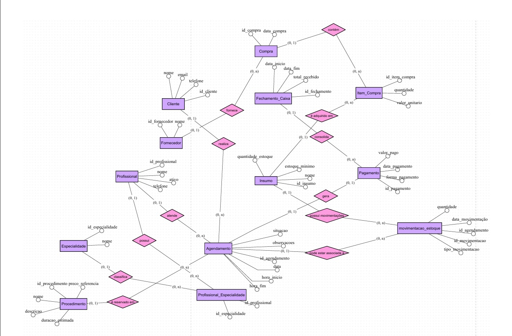
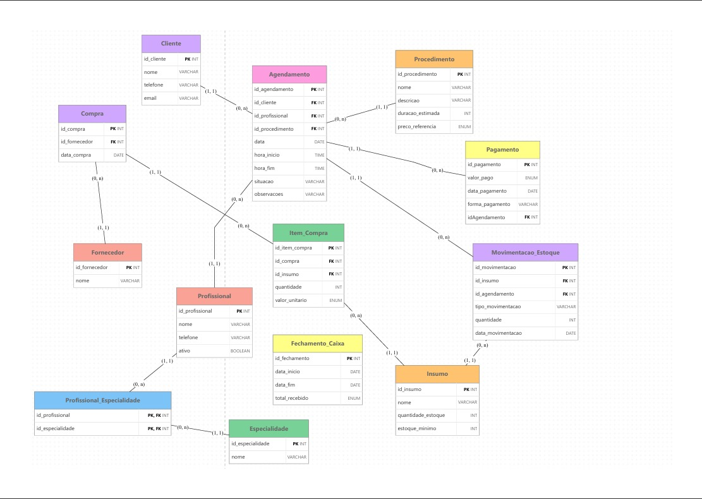

# 💇‍♀️ Salão dos Primos — Sistema de Gestão

> Projeto acadêmico de modelagem, implementação e documentação de banco de dados para o gerenciamento das informações do Salão dos Primos.

## 📌 Sobre o projeto

O projeto tem como objetivo desenvolver uma estrutura de banco de dados relacional para organizar e centralizar as informações utilizadas na gestão do Salão dos Primos.

A proposta contempla o registro e a organização de informações relacionadas a clientes, profissionais, procedimentos, especialidades e agendamentos, além dos demais processos representados no modelo de dados.

O banco de dados foi planejado para permitir maior organização das informações, facilitar consultas e apoiar a tomada de decisões administrativas.

---

# 👥 Integrantes

| Nome completo | RGM | GitHub |
|---|---|---|
| Franciele Souza de Jesus | 47643323 | https://github.com/FrancieleSZ |
| Julia Parra | 47566604 | https://github.com/juliaatriz |
| Emilly Rodrigues de Souza | 47508248 | https://github.com/emillyrodrigues-tech |
| Kamilly Vitória Alves da Silva | 46919431 | https://github.com/KamillyVicks  |
---

# 1. Relatório Técnico Final

## 1.1 Revisão do Modelo Conceitual

### Caracterização da organização

**Nome:** Salão dos Primos  
**Natureza:** Organização do ramo de prestação de serviços de beleza.  
**Responsável:** Alaide Lacerda — Cabelereira.

O estabelecimento conta com aproximadamente 4 profissionais e atende uma quantidade estimada de 30 a 50 clientes. Esses números ajudam a dimensionar a necessidade de organização dos cadastros e dos atendimentos.

### Problemas e necessidades identificados

Os principais pontos que o sistema pretende atender são:

- **P1 — Organização dos clientes:** centralizar os dados cadastrais dos clientes.
- **P2 — Controle dos profissionais:** manter informações dos profissionais e de suas especialidades.
- **P3 — Organização dos agendamentos:** registrar os atendimentos, seus horários, responsáveis e situações.
- **P4 — Consulta de informações:** facilitar a recuperação do histórico de atendimentos e dos dados cadastrados.

### Escopo do sistema

O modelo de dados contempla as seguintes entidades:

1. Cliente;
2. Profissional;
3. Procedimento;
4. Especialidade;
5. Profissional_Especialidade;
6. Agendamento;
7. Pagamento;
8. Fornecedor;
9. Compra;
10. Item_Compra;
11. Insumo;
12. Movimentacao_Estoque;
13. Fechamento_Caixa.

O escopo definitivo deve corresponder aos processos efetivamente realizados pelo estabelecimento e confirmados com o responsável.

### Justificativa da escolha

O Salão dos Primos foi escolhido por ser uma organização real, com atividades que envolvem cadastro de clientes, profissionais e organização de atendimentos. O estabelecimento oferece um cenário adequado para estudar a modelagem de dados e desenvolver uma solução de gerenciamento de informações.

### Evidências da organização

- Endereço: R. Bernardino Vergueiro, 276 - Jardim Jaú (Zona Leste), São Paulo - SP, 03710-060.
- Google Maps / Perfil da organização: [https://share.google/cTK1avqQON6QACScm].
- Contato: 11 94696-7621.
- Fotografias da organização e da visita: 
  

**Responsável pela organização:** Alaide Souza Lacerda - 11 94400-0738.

### Relato da entrevista

- **Entrevistado:** Alaide.
- **Integrantes participantes:** Franciele Souza.
- **Data:** 20/09/2026.
- **Local:** Salão dos Primos.

**Informações obtidas na entrevista:**  
O responsável informou que o salão realiza seus agendamentos de forma manual, utilizando principalmente um caderno e o WhatsApp para organizar os horários dos clientes. Atualmente, o controle das atividades é feito pela própria responsável, que registra os compromissos, consulta a disponibilidade dos profissionais e combina os procedimentos diretamente com os clientes. Também foi informado que os valores dos serviços podem variar conforme a necessidade de cada cliente, sendo definidos após uma avaliação prévia. O salão não utiliza atualmente um sistema informatizado para gerenciar essas informações.

**Observações presenciais:**  
Durante a visita, foi possível observar que o salão possui uma organização simples e que os processos administrativos são realizados manualmente. Os agendamentos são anotados em um caderno e complementados por conversas pelo WhatsApp. Não foi identificado o uso de computadores ou sistemas específicos para o gerenciamento dos atendimentos. Também foi observado que a responsável concentra grande parte das atividades de organização, como o controle dos horários, o contato com os clientes e a definição dos serviços. Essa dinâmica demonstra a importância de uma ferramenta informatizada que possa centralizar e facilitar o gerenciamento das informações do salão.

**Comprovação:** fotografia da entrevista armazenada no repositório.

O levantamento completo está disponível em: [`levantamento/levantamento.md`](levantamento/levantamento.md).

### Processos de negócio

Os processos representados no projeto envolvem:

- Cadastro e consulta de clientes;
- Cadastro e gerenciamento de profissionais;
- Cadastro de procedimentos;
- Associação entre profissionais e especialidades;
- Registro e gerenciamento de agendamentos;
- Registro de pagamentos;
- Cadastro de fornecedores;
- Registro de compras;
- Registro dos itens adquiridos;
- Controle de insumos;
- Registro de movimentações de estoque;
- Fechamento de caixa por período.

### Requisitos funcionais

| Código | Descrição |
|---|---|
| RF01 | Permitir cadastrar clientes. |
| RF02 | Permitir cadastrar procedimentos. |
| RF03 | Permitir cadastrar profissionais. |
| RF04 | Permitir registrar agendamentos relacionando cliente, profissional e procedimento. |
| RF05 | Impedir conflitos de horários entre agendamentos ativos de um mesmo profissional. |
| RF06 | Permitir cancelar agendamentos, mantendo o registro de sua situação. |
| RF07 | Permitir remarcar agendamentos. |
| RF08 | Permitir consultar a agenda dos profissionais. |
| RF09 | Permitir registrar a conclusão de um atendimento. |
| RF10 | Permitir consultar o histórico de agendamentos. |
| RF11 | Permitir registrar pagamentos relacionados aos agendamentos. |
| RF12 | Permitir cadastrar fornecedores e registrar compras. |
| RF13 | Permitir registrar itens de compras e suas respectivas quantidades e valores. |
| RF14 | Permitir controlar o estoque de insumos. |
| RF15 | Permitir registrar movimentações de entrada e saída de insumos. |
| RF16 | Permitir consultar as movimentações de estoque. |
| RF17 | Permitir realizar o fechamento de caixa por período, calculando o total recebido com base nos pagamentos registrados. |

### Requisitos não funcionais

| Código | Descrição |
|---|---|
| RNF01 | O banco de dados deverá ser implementado utilizando MySQL. |
| RNF02 | O sistema deverá manter a integridade dos relacionamentos por meio de chaves primárias e estrangeiras. |
| RNF03 | Os dados deverão ser armazenados de maneira organizada e estruturada. |
| RNF04 | O acesso às informações deverá respeitar as permissões definidas para cada usuário. |
| RNF05 | O projeto deverá considerar a proteção dos dados pessoais dos clientes, respeitando os princípios da LGPD. |

### Regras de negócio

| Código | Regra |
|---|---|
| RN01 | Todo agendamento deve estar associado a um cliente cadastrado. |
| RN02 | Todo agendamento deve estar associado a um profissional. |
| RN03 | Todo agendamento deve estar associado a um procedimento. |
| RN04 | Um profissional não pode possuir agendamentos ativos em horários conflitantes. |
| RN05 | Profissionais inativos não podem receber novos agendamentos. |
| RN06 | Um agendamento pode possuir, no máximo, um pagamento registrado. |
| RN07 | Cada compra deve estar associada a um fornecedor. |
| RN08 | Cada item de compra deve estar associado a uma compra e a um insumo. |
| RN09 | Toda movimentação de estoque deve estar associada a um insumo. |
| RN10 | O fechamento de caixa deve considerar os pagamentos registrados dentro do período informado. |

### DER conceitual revisado

O DER conceitual representa as entidades, seus atributos e os relacionamentos existentes entre elas, seguindo a notação visual exigida pelo professor.

**Ferramenta utilizada:** brModelo.



### Revisões realizadas em relação à Entrega 1

| Apontamento da correção | Alteração realizada | Justificativa |
|---|---|---|
| DER Lógico e Conceitual | Corrigido | Não estava compativel com o MD |
| Pagamento | Introduzido no MD e SQL | Estava faltando |
| Fornecedores | Corrigido e explicado | Estava faltando |

---

## 1.2 Conversão do Modelo Conceitual para o Modelo Lógico

A conversão do modelo conceitual para o modelo lógico foi realizada considerando as entidades, atributos, relacionamentos e cardinalidades identificados no DER.

As entidades foram transformadas em tabelas relacionais, enquanto os atributos passaram a representar colunas.

Os relacionamentos foram implementados por meio de chaves estrangeiras. Nos relacionamentos muitos-para-muitos, foram utilizadas tabelas associativas.

### Conversão dos relacionamentos

- **Cliente e Agendamento:** relacionamento 1:N, implementado por meio da FK `id_cliente` em Agendamento.
- **Profissional e Agendamento:** relacionamento 1:N, implementado por meio da FK `id_profissional`.
- **Procedimento e Agendamento:** relacionamento 1:N, implementado por meio da FK `id_procedimento`.
- **Profissional e Especialidade:** relacionamento N:N, resolvido pela tabela `Profissional_Especialidade`.
- **Agendamento e Pagamento:** relacionamento 1:0..1, implementado por meio da FK `id_agendamento` em Pagamento, com restrição de unicidade.
- **Fornecedor e Compra:** relacionamento 1:N, implementado pela FK `id_fornecedor`.
- **Compra e Item_Compra:** relacionamento 1:N, implementado pela FK `id_compra`.
- **Insumo e Item_Compra:** relacionamento 1:N, implementado pela FK `id_insumo`.
- **Insumo e Movimentacao_Estoque:** relacionamento 1:N, implementado pela FK `id_insumo`.
- **Agendamento e Movimentacao_Estoque:** relacionamento opcional, representado pela FK `id_agendamento`.

O fechamento de caixa calcula o total recebido considerando os pagamentos registrados dentro do período informado. Não foi estabelecida uma FK direta entre Fechamento_Caixa e Pagamento.

---

## 1.3 Definição de Chaves Primárias e Estrangeiras

| Tabela | Chave primária | Chaves estrangeiras |
|---|---|---|
| Cliente | id_cliente | — |
| Profissional | id_profissional | — |
| Procedimento | id_procedimento | — |
| Especialidade | id_especialidade | — |
| Profissional_Especialidade | id_profissional + id_especialidade | id_profissional, id_especialidade |
| Agendamento | id_agendamento | id_cliente, id_profissional, id_procedimento |
| Pagamento | id_pagamento | id_agendamento |
| Fornecedor | id_fornecedor | — |
| Compra | id_compra | id_fornecedor |
| Item_Compra | id_item_compra | id_compra, id_insumo |
| Insumo | id_insumo | — |
| Movimentacao_Estoque | id_movimentacao | id_insumo, id_agendamento |
| Fechamento_Caixa | id_fechamento | — |

As chaves primárias identificam individualmente os registros. As chaves estrangeiras garantem a referência entre as tabelas relacionadas.

---

## 1.4 Processo de Normalização (1FN, 2FN e 3FN)

A normalização foi considerada durante a organização das tabelas, buscando reduzir redundâncias e preservar a integridade dos dados.

### Primeira Forma Normal (1FN)

A estrutura das tabelas utiliza atributos atômicos, evitando grupos repetitivos e listas de valores em uma mesma coluna.

As informações que possuem relações próprias foram separadas em tabelas específicas.

### Segunda Forma Normal (2FN)

A estrutura busca garantir que os atributos não-chave dependam da chave primária completa.

Na tabela `Profissional_Especialidade`, a associação entre profissional e especialidade utiliza uma chave composta.

### Terceira Forma Normal (3FN)

As informações foram distribuídas entre entidades específicas para evitar dependências transitivas desnecessárias.

Por exemplo, os dados dos fornecedores ficam na tabela `Fornecedor`, enquanto os registros de compras ficam na tabela `Compra`.

**Resultado:** a estrutura foi organizada para reduzir duplicidade, facilitar manutenção e manter a consistência das informações.

---

## 1.5 Justificativas Técnicas das Decisões

### Chaves primárias

Foram utilizados identificadores próprios para as principais entidades, como `id_cliente`, `id_profissional` e `id_agendamento`, permitindo identificar cada registro sem depender de atributos que possam ser alterados.

Na tabela `Profissional_Especialidade`, a identificação da associação é feita pela combinação de profissional e especialidade.

### Chaves estrangeiras

As chaves estrangeiras implementam os relacionamentos entre as tabelas e evitam referências a registros inexistentes.

### Restrições de integridade

O banco deverá utilizar restrições como:

- `NOT NULL` para atributos obrigatórios;
- `UNIQUE` para valores que não podem se repetir;
- `CHECK` para validar condições específicas;
- `DEFAULT` para valores padrão;
- `FOREIGN KEY` para garantir integridade referencial.

### Decisões arquiteturais

A tabela `Profissional_Especialidade` resolve o relacionamento muitos-para-muitos entre profissionais e especialidades.

A tabela `Item_Compra` permite registrar diferentes insumos dentro de uma mesma compra.

A tabela `Movimentacao_Estoque` mantém o histórico de entradas e saídas de insumos.

A tabela `Fechamento_Caixa` registra o período de fechamento e o total recebido, calculado a partir dos pagamentos correspondentes ao período.

---

## 1.6 Proposta de Arquitetura Analítica para BI e IA

A estrutura do banco de dados permite desenvolver consultas e relatórios que auxiliam o acompanhamento das atividades do estabelecimento.

### Indicadores gerenciais (KPIs) propostos

| Indicador | Objetivo |
|---|---|
| Quantidade de agendamentos por período | Acompanhar o volume de atendimentos. |
| Procedimentos mais realizados | Identificar os serviços com maior procura. |
| Atendimentos por profissional | Acompanhar a distribuição dos atendimentos. |
| Taxa de cancelamento | Identificar a proporção de agendamentos cancelados. |
| Total recebido por período | Acompanhar os valores registrados nos pagamentos. |
| Insumos abaixo do estoque mínimo | Identificar necessidades de reposição. |
| Compras por fornecedor | Acompanhar os registros de aquisição. |

### Potencial para BI

Os dados armazenados podem alimentar painéis gerenciais com informações sobre:

- Volume de atendimentos;
- Desempenho dos procedimentos;
- Distribuição dos agendamentos;
- Recebimentos por período;
- Situação dos insumos;
- Histórico de compras.

### Aplicações analíticas e de IA

Com uma quantidade adequada de dados históricos, podem ser exploradas aplicações como:

- Análise de padrões de agendamento;
- Identificação de períodos com maior procura;
- Previsão de demanda por procedimentos;
- Identificação de padrões de consumo de insumos;
- Apoio ao planejamento de compras.

Essas aplicações são propostas futuras e dependem da disponibilidade e qualidade dos dados armazenados.

### Rastreabilidade

| Problema ou KPI | Tabelas envolvidas | Consulta no script |
|---|---|---|
| P1 — Organização dos clientes | Cliente | [G01] |
| P2 — Controle dos profissionais | Profissional, Especialidade, Profissional_Especialidade | [G02] |
| P3 — Organização dos agendamentos | Agendamento, Cliente, Profissional, Procedimento | [G03] |
| Quantidade de atendimentos por período | Agendamento | [G04] |
| Procedimentos mais realizados | Procedimento, Agendamento | [G05] |
| Total recebido por período | Pagamento | [G06] |
| Insumos abaixo do estoque mínimo | Insumo | [G07] |
| Compras por fornecedor | Fornecedor, Compra, Item_Compra | [G08] |

[Atualizar os códigos de acordo com as consultas que realmente existirem no script SQL. Cada problema e KPI precisa ter uma consulta correspondente.]

---

# 2. Modelo Lógico Relacional

O modelo lógico apresenta as tabelas, colunas, tipos de dados, chaves primárias, chaves estrangeiras e cardinalidades convertidas.

**Ferramenta utilizada:** brModelo.



O modelo lógico é composto pelas 13 tabelas apresentadas na seção 1.1.

---

# 3. Script SQL Completo

O banco de dados foi planejado para utilização no **MySQL**.

O script SQL completo deverá conter:

1. Criação do banco de dados;
2. Criação das tabelas;
3. Definição das chaves primárias e estrangeiras;
4. Restrições de integridade;
5. Inserção da massa de dados;
6. Consultas utilizando `SELECT` e `JOIN`;
7. Exemplos de `UPDATE`;
8. Exemplos de `DELETE`;
9. Consultas gerenciais;
10. Consultas de auditoria.

**Arquivo:** [`docs/script.sql`](docs/script.sql)

---

# 4. Massa de Dados

A massa de dados deverá ser fictícia, preservando a privacidade dos clientes e demais pessoas relacionadas ao estabelecimento.

Os registros deverão representar situações coerentes com os processos modelados, incluindo diferentes clientes, profissionais, procedimentos, agendamentos, pagamentos, compras e movimentações de estoque.

A quantidade de registros deverá ser justificada pelo porte da organização e pelo volume de atividades observado durante o levantamento.

**Arquivo:** [`docs/massa_de_dados.sql`](docs/massa_de_dados.sql)

---

# 5. Repositório GitHub

O repositório organiza os documentos, diagramas e scripts produzidos durante o desenvolvimento do projeto.

### Estrutura proposta

```text
Salao-dos-Primos/
│
├── README.md
│
├── docs/
│   ├── DER_conceitual.png
│   ├── DER_logico.png
│   ├── dicionario_dados.html
│   ├── script.sql
│   └── massa_de_dados.sql
│
├── levantamento/
│   └── levantamento.md
│
├── evidencias/
│   ├── visita.jpg
│   └── entrevista.jpg
│
└── apresentacao/
    └── apresentacao_final.pdf
```

[Adaptar a estrutura aos nomes e arquivos efetivamente existentes.]

### Links dos artefatos

- [DER conceitual](docs/DER_conceitual.png)
- [Modelo lógico](docs/DER_logico.png)
- [Dicionário de dados](docs/dicionario_dados.html)
- [Script SQL](docs/script.sql)
- [Massa de dados](docs/massa_de_dados.sql)
- [Levantamento](levantamento/levantamento.md)
- [Evidências](evidencias/)
- [Apresentação final](apresentacao/apresentacao_final.pdf)

---

# 6. Uso de Inteligência Artificial

As ferramentas de inteligência artificial foram utilizadas como apoio ao desenvolvimento do projeto, principalmente para auxiliar na organização de ideias, revisão da modelagem e esclarecimento de conceitos técnicos.

O uso das ferramentas deve ser documentado de forma transparente, incluindo os prompts, as respostas relevantes, as alterações realizadas pelo grupo e as decisões finais.

### Registro de utilização

| Ferramenta | Etapa | Utilização |
|---|---|---|
| ChatGPT | Modelagem e documentação | Apoio na organização dos diagramas, estruturação do README e esclarecimento de conceitos de banco de dados. |
| ChatGPT | SQL | Apoio na elaboração e revisão de estruturas SQL e relacionamentos. |

### Reflexão crítica

As respostas geradas por inteligência artificial não foram consideradas automaticamente corretas. As sugestões precisaram ser analisadas e adaptadas conforme os requisitos do projeto e as orientações do professor.

As decisões finais de modelagem devem ser revisadas e compreendidas pelos integrantes do grupo.

### Prompts Utilizados

"Considerando o levantamento de requisitos realizado em um salão de beleza de pequeno porte, analise a estrutura de dados necessária para representar os processos internos do estabelecimento. O salão possui quatro profissionais, realiza agendamentos e trabalha com diferentes especialidades e procedimentos. Avalie as entidades necessárias, seus atributos, chaves primárias e estrangeiras, além dos relacionamentos e suas respectivas cardinalidades. Considere a necessidade de evitar redundância e manter a integridade referencial."

"Com base no funcionamento de um salão que realiza seus agendamentos manualmente por meio de caderno e WhatsApp, identifique as principais regras de negócio que devem ser consideradas na implementação de um banco de dados. Leve em consideração a disponibilidade dos profissionais, a associação entre profissionais e especialidades, o registro dos procedimentos e a possibilidade de alteração ou cancelamento de agendamentos. Considere também que os valores dos serviços são definidos após avaliação, não sendo necessariamente fixos."

"Revise a estrutura de um banco de dados relacional desenvolvido para o gerenciamento de um salão de beleza. Verifique se os relacionamentos entre as tabelas estão coerentes com as regras de negócio, se as chaves primárias e estrangeiras foram definidas corretamente e se existem possíveis problemas de integridade ou inconsistências. Analise também a utilização de tipos de dados, restrições NOT NULL, UNIQUE e CHECK, sugerindo ajustes quando necessário."

---

# 7. Apresentação Corporativa Final

A apresentação final terá duração de 8 minutos e seguirá a ordem estabelecida pelo professor.

### Roteiro da apresentação

1. Contextualização dos problemas identificados no estabelecimento;
2. Apresentação da solução proposta;
3. Apresentação do modelo lógico;
4. Demonstração da implementação SQL;
5. Demonstração das consultas gerenciais e de auditoria;
6. Apresentação do potencial para BI e IA;
7. Benefícios da solução para a tomada de decisão.

A demonstração deverá utilizar o banco de dados implementado e as consultas existentes no script SQL.

**Arquivo:** [`apresentacao/apresentacao_final.pdf`](apresentacao/apresentacao_final.pdf)

---

## Considerações finais

O projeto busca aplicar os conceitos de modelagem de dados, normalização, integridade referencial e implementação SQL em um cenário organizacional real.

A estrutura proposta permite organizar as informações do Salão dos Primos e criar uma base para consultas gerenciais e futuras melhorias no controle dos processos do estabelecimento.

O desenvolvimento também proporciona a aplicação prática dos conhecimentos de banco de dados relacionais, documentação técnica e trabalho colaborativo utilizando GitHub.

---

<sub>Projeto acadêmico — Entrega 2 | Ciência da Computação | UNICID (Universidade Cidade de São Paulo) | 2 Semestre/2026</sub>
